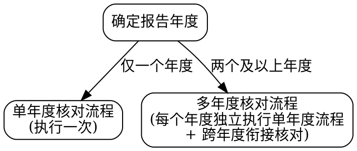

# 审计报告核对

## Overview

系统化核对审计报告与财务报表的勾稽关系，确保数据逻辑自洽、跨期衔接一致，生成标准化核对结果。

**核心原则：** 所有合计数必须逐项重算验证，不能直接引用报表或附注中的合计行。

## 核对约束（必须遵守）

| # | 约束 | 说明 |
|:-:|------|------|
| 1 | **每项核对必须执行，不得随意跳过** | 下方列出的所有核对步骤（Step 1-6），每一步都必须执行并记录结果，不允许以"大概没问题"为由跳过 |
| 2 | **无相关内容也需列示** | 若被核对报告中不包含某科目或某附注表格（如无短期投资、无固定资产），核对结果必须记录为"无相关内容"，在结果表中列出该行并标注，**不得直接删除检查项** |
| 3 | **结果必记录** | 每一项核对都必须有明确的状态标记：✅ 通过 / ❌ 不通过 / ➖ 无相关内容。不能留空或默认为通过 |
| 4 | **不足时不合并** | 不得将多个检查项合并为一个笼统描述。一个公式对应一个检查项，逐项列出 |

> **如有被核对报告确实不存在某科目或某张表格，在核对报告中标注"被审计单位无此业务/无此表格"，该行仍保留在核对结果中，通过率统计时该行不计入。**

---

## Workflow: 确定报告年度 → 选择核对流程



**第一步：确定报告年度** — 分析需要核对的报告覆盖哪些年度。单年度与多年度执行不同的核对流程。

---

## 一、单年度核对流程

### Step 0：通过 MinerU 提取文件

将需要审核的 docx/xlsx 文件转换为 Markdown 格式：

```powershell
# 提取报告正文
mineru-open-api flash-extract "路径\审计报告.docx" -o "导出\报告.md"

# 提取财务报表
mineru-open-api flash-extract "路径\财务报表.xlsx" -o "导出\财务报表.md"

# 提取附注
mineru-open-api flash-extract "路径\附注.docx" -o "导出\附注.md"
```

> 详细提取指南见 `references/extraction-guide.md`

### Step 1：基础信息核对（核对a）

核对封面、报告正文、财务报表、附注中的以下信息是否一致：

| 检查项 | 检查位置 | 一致性要求 |
|--------|---------|-----------|
| 被审计公司名称 | 封面/正文/报表/附注 | 四处一致 |
| 被审计年度 | 封面/正文/报表/附注 | 四处一致 |
| 报告日期 | 封面/正文 | 两处一致 |
| 目录页码 | 目录页 vs 各文件实际页码 | 页码对应正确 |

### Step 2：财务报表内部勾稽核对

#### 2a：资产负债表期末余额、年初余额逐项加总核对

**公式验证（分别对期末余额、年初余额执行）：**

```
存货 = 原材料 + 在产品 + 库存商品 + 周转材料
流动资产合计 = 货币资金 + 短期投资 + 应收票据 + 应收账款 + 预付账款
             + 应收股利 + 应收利息 + 其他应收款 + 存货 + 其他流动资产
固定资产账面价值 = 固定资产原值 - 累计折旧
非流动资产合计 = 长期债权投资 + 长期股权投资 + 固定资产账面价值
               + 在建工程 + 工程物资 + 固定资产清理 + 生产性生物资产
               + 无形资产 + 开发支出 + 长期待摊费用 + 其他非流动资产
资产总计 = 流动资产合计 + 非流动资产合计
流动负债合计 = 短期借款 + 应付票据 + 应付账款 + 预收账款
             + 应付职工薪酬 + 应交税费 + 应付利息 + 应付利润
             + 其他应付款 + 其他流动负债
非流动负债合计 = 长期借款 + 长期应付款 + 递延收益 + 其他非流动负债
所有者权益合计 = 实收资本 + 资本公积 + 盈余公积 + 未分配利润
```

#### 2b：利润表本年累计数、上年累计数逐项加总核对

```
税金及附加 = 消费税 + 城市维护建设税 + 资源税 + 土地增值税
           + 城镇土地使用税 + 房产税 + 车船税 + 印花税
           + 教育费附加 + 矿产资源税 + 排污费
营业利润 = 营业收入 - 营业成本 - 税金及附加 - 销售费用
         - 管理费用 - 财务费用 + 投资收益
利润总额 = 营业利润 + 营业外收入 - 营业外支出
净利润 = 利润总额 - 所得税费用
```

#### 2c：现金流量表本年累计发生额、上年累计发生额加总核对

```
经营活动产生的现金流量净额 = 销售产成品、商品、提供劳务收到的现金
                            + 收到的税费返还
                            + 收到其他与经营活动有关的现金
                            - 购买原材料、商品、接受劳务支付的现金
                            - 支付的职工薪酬
                            - 支付的税费
                            - 支付其他与经营活动有关的现金
投资活动产生的现金流量净额 = 收回短期投资、长期债券投资和长期股权投资收到的现金
                            + 取得投资收益收到的现金
                            + 处置固定资产、无形资产和其他非流动资产收回的现金净额
                            - 短期投资、长期债券投资和长期股权投资支付的现金
                            - 购建固定资产、无形资产和其他非流动资产支付的现金
筹资活动产生的现金流量净额 = 取得借款收到的现金
                            + 吸收投资者投资收到的现金
                            - 偿还借款本金支付的现金
                            - 偿还借款利息支付的现金
                            - 支付的其他与筹资活动有关的现金
现金净增加额 = 经营活动产生的现金流量净额
             + 投资活动产生的现金流量净额
             + 筹资活动产生的现金流量净额
             + 汇率变动对现金的影响额
期末现金余额 = 现金净增加额 + 期初现金余额
```

**跨期验证：** 本年累计发生额中的期初现金余额 = 上年累计发生额的期末现金余额

### Step 3：表格间数据勾稽核对（核对e）

| 勾稽关系 | 验证公式 |
|---------|---------|
| 资产负债表货币资金 ↔ 现金流量表 | 货币资金期末余额 = 现金流量表本年累计发生额的期末现金余额 |
| 资产负债表货币资金 ↔ 现金流量表 | 货币资金年初余额 = 现金流量表上年累计发生额的期末现金余额 |
| 资产负债表未分配利润 ↔ 利润表 | 未分配利润期末余额 - 未分配利润年初余额 = 利润表净利润本年累计数 |

### Step 4：附注表格内部数据核对（核对f）

对每种附注表格类型，执行对应的勾稽验证：

#### 账龄表（应收账款/其他应收款/应付账款等）

```
各段账龄期末余额之和 = 合计期末余额
各段账龄期初余额之和 = 合计期初余额
```

#### 前五名客户/供应商明细表

```
各客户金额之和 = 合计
各客户余额比例 = 各客户期末余额 / 对应科目期末余额 × 100%
各客户比例之和 = 100%（近似）
```

#### 固定资产及累计折旧表

```
各项目期初余额 + 本期增加 - 本期减少 = 期末余额
账面原值 - 累计折旧 - 减值准备 = 账面价值
```

#### 长期待摊费用表

```
各项目之和 = 合计
各项目期初余额 + 本期增加 - 本期减少 = 期末余额
```

#### 应付职工薪酬表

```
各项目之和 = 合计
各项目期初余额 + 本期增加 - 本期减少 = 期末余额
```

#### 实收资本表

```
各股东期初余额之和 = 合计的期初余额
各股东期末余额之和 = 合计的期末余额
各股东本期增加之和 = 合计的本期增加
各股东本期减少之和 = 合计的本期减少
各股东期初余额 + 本期增加 - 本期减少 = 期末余额
```

#### 只有期末余额、期初余额的表格

```
各项目期末余额之和 = 合计的期末余额
各项目期初余额之和 = 合计的期初余额
```

#### 只有本期发生额、上期发生额的表格

```
各项目本期发生额之和 = 合计的本期发生额
各项目上期发生额之和 = 合计的上期发生额
```

### Step 5：报表与附注交叉核对（核对g）

```
资产负债表/利润表科目的期初数 = 附注对应科目的期初数
资产负债表/利润表科目的期末数 = 附注对应科目的期末数
```

> 每张资产负债表/利润表的行项目，都应有对应的附注明细表。逐项核对。

### Step 6：文本表述问题核对（核对3）

检查报告正文、附注中的以下问题：

| 类别 | 检查内容 |
|------|---------|
| 缺字 | 如"政府拨情况"缺"款"、"未政府补助收入"缺"收到" |
| 错字 | 如"认"真写成"认证"、"关与"写成"关于" |
| 标点 | 多余句号"。。"、英文括号混用、引号不配对 |
| 格式 | 数字后缺"元"、年度格式不一致、多余空格 |
| 表述问题 | 缺主语、动宾不搭配、模板残留占位符 |

> 常见问题模式详见 `references/common-issues.md`

---

## 二、多年度核对流程

多年度核对 = 对每个年度单独执行单年度流程 + 跨年度衔接核对 + 问题传播核对

### 第一遍：纵向核对

对每个年度分别执行完整的[单年度核对流程](#一单年度核对流程)。

> 建议并行执行各年度的核对，提高效率。

### 第二遍：横向核对（跨年度数据衔接）

#### 2a：资产负债表跨年衔接

```
本年度资产负债表期末余额 = 下一年度资产负债表年初余额
```

#### 2b：利润表跨年衔接

```
本年度利润表本年累计数 = 下一年度利润表上年累计数
```

#### 2c：现金流量表跨年衔接

```
本年度现金流量表本年累计发生额 = 下一年度现金流量表上年累计发生额
```

#### 2d：附注跨年衔接

```
本年度附注期末余额 = 下一年度附注期初余额
本年度附注本期发生额 = 下一年度附注上期发生额
```

### 第三遍：问题传播核对

核对上一年度发现的问题，是否累积/传播到下一年度：

| 传播模式 | 说明 | 处理建议 |
|---------|------|---------|
| 全部年份存在 | 同一问题在所有年度均出现 | 检查模板源，统一修正 |
| 首次出现后传播 | 在 Year N 出现，后续年度也有 | 联动修正，检查引用关系 |
| 早期存在，后期已修正 | 早期年份有，最新年份已无 | 回溯修正早期年份 |
| 被引用传播 | Year N 错误数据被 Year N+1 引用 | 修正后检查所有引用处 |

---

## 三、输出格式

核对结果文件必须包含以下部分：

### 1. 核对范围
- 被审计单位名称
- 涉及年度（单年度/多年度）
- 核对文件列表（报告正文/财务报表/附注）

### 2. 各年度核对结果
按年度逐项列示，**每一项都必须有状态标记**：

| 状态标记 | 含义 |
|:--------:|------|
| ✅ | 通过 |
| ❌ | 不通过（数据不一致/存在错误） |
| ➖ | 无相关内容（被审计单位无此业务/无此表格） |

必须包含以下板块（每板块逐项列出）：
- 基础信息核对结果（公司名/年度/日期/页码）
- 财务报表勾稽结果（资产负债/利润/现金流量）
- 跨表勾稽结果
- 附注表格核对结果
- 报表与附注交叉核对结果
- 文本问题清单

### 3. 问题汇总
按优先级列示所有问题：

| 优先级 | 年度 | 问题描述 | 类别 | 建议处理 |
|:------:|:----:|---------|:----:|---------|
| 高 | 2023 | 净利润与未分配利润表不一致 | 数据异常 | 核实修正 |
| 中 | 2023-2024 | 表头错字"占预付账款余额的比例" | 文字错误 | 统一修正 |
| 低 | 2024 | 数字后缺"元" | 格式问题 | 补充修正 |

### 4. 重点关注建议
- 数据异常项：优先核实
- 跨年度传播问题：联动修正
- 系统性问题（模板/公式）：从根本上修正

---

## 数值处理规则

| 源格式 | 处理方法 | 示例 |
|--------|---------|------|
| `1,775,477.94`（千分位逗号） | 去掉逗号 | → `1775477.94` |
| `5102.910000000001`（浮点数精度） | 四舍五入到2位小数 | → `5102.91` |
| 空值/缺失 | 按 0 处理 | — |
| 公式计算结果 | 手动重算，不直接引用 | — |

## 常见陷阱

| 陷阱 | 处理方式 |
|------|---------|
| 浮点数精度导致微小差异 | 四舍五入到两位小数后比较 |
| 附注合计行本身有误 | 逐项重算，不直接引用合计行 |
| 期初数漏检（仅核对期末数） | 期初和期末必须都验证 |
| 跨年衔接漏检 | 多年度时必须做横向核对 |
| 只核对报表不核对附注 | 附注表格内明细之和必须等于合计 |
| MinerU 提取错位/遗漏 | 关键数据回源文件二次确认 |
